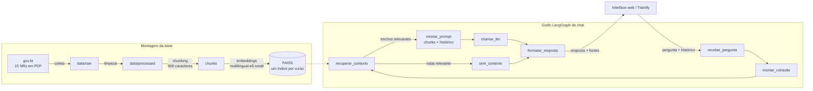

# Trainify AI — RAG para treinamento corporativo

Microserviço em Python que dá inteligência artificial ao **Trainify** (plataforma
de treinamento corporativo, projeto de PI5). Ele resolve dois problemas:

1. **Chat com o conteúdo dos cursos:** o aluno, o instrutor e o gestor fazem perguntas e
   recebem respostas baseadas **apenas** no material dos cursos que podem ver, com as fontes.
2. **Geração de quiz:** a partir do material que o instrutor subiu (texto, PDF ou
   transcrição), a IA sugere perguntas de múltipla escolha, que o instrutor revisa antes de publicar.

O serviço funciona sozinho, com interface web própria e uma base de conhecimento
sobre as **Normas Regulamentadoras (NRs)** de segurança do trabalho. Também se liga
ao backend Spring Boot do Trainify por HTTP.



## Atendimento aos requisitos da atividade

| Requisito | Onde está |
|---|---|
| Interface web simples (pergunta, envio, resposta, comunicação com o back-end) | `app/static/index.html`, servida em `http://localhost:8000` |
| Back-end em Python | FastAPI, `app/main.py` |
| RAG orquestrado com LangGraph, com etapas explícitas | `app/graphs/chat_graph.py`: `receber_pergunta → montar_consulta → recuperar_contexto → montar_prompt → chamar_llm → formatar_resposta` |
| Base de conhecimento de domínio específico e volumosa | 15 NRs: **447 páginas de PDF, ~146 mil palavras, 1.327 chunks** (detalhes abaixo) |
| LLM externa usada só na geração | Só o nó `chamar_llm` chama a LLM. Embeddings, busca e perguntas de seguimento rodam localmente, sem LLM |
| Contexto com os chunks recuperados + mensagens anteriores | Nó `montar_prompt`: trechos no prompt de sistema e as últimas 6 mensagens como histórico |
| Sem API pronta de chatbot | A API (`/demo/chat`, `/api/chat`) é nossa; a LLM é usada como modelo de linguagem via LangChain |

## Base de conhecimento

- **Domínio:** segurança e saúde no trabalho, Normas Regulamentadoras do Ministério do Trabalho e Emprego.
- **Fonte:** textos oficiais consolidados, publicados em [gov.br/trabalho-e-emprego](https://www.gov.br/trabalho-e-emprego/pt-br/acesso-a-informacao/participacao-social/conselhos-e-orgaos-colegiados/comissao-tripartite-partitaria-permanente/normas-regulamentadora/normas-regulamentadoras-vigentes) (domínio público).
- **Volume:** 15 normas, 447 páginas, ~146 mil palavras, 1.327 chunks indexados.
- **Organização:** um curso de demonstração com 3 módulos, em que cada NR é uma aula (`data/curso_nrs.json`):

| Módulo | Aulas |
|---|---|
| Gestão de segurança e saúde no trabalho | NR-1, NR-5, NR-7, NR-9 |
| Proteção individual e ambiente de trabalho | NR-6, NR-17, NR-23, NR-24, NR-26 |
| Atividades de alto risco | NR-10, NR-11, NR-12, NR-18, NR-33, NR-35 |

- **Origem de cada arquivo** (URL e data da coleta): `data/raw/manifest.json`
- **Textos limpos:** `data/processed/*.txt`, versionados. Não é preciso rodar a coleta de novo para executar o projeto.

## Pipeline

| Etapa | Arquivo | O que faz |
|---|---|---|
| 1. Coleta | `scripts/coletar_nrs.py` | Acha na página do gov.br o PDF consolidado mais recente de cada NR e baixa para `data/raw/` |
| 2. Limpeza | `scripts/processar_nrs.py` + `app/text_processing.py` | Extrai o texto (pypdf), tira cabeçalhos e rodapés repetidos, números de página, histórico de portarias e sumário, desfaz a hifenização e refaz os parágrafos (cada item numerado da norma vira um parágrafo) |
| 3. Chunking | `app/text_processing.py` | `RecursiveCharacterTextSplitter`, 900 caracteres com 150 de sobreposição, quebrando de preferência entre parágrafos. Cada chunk recebe o título da aula como prefixo |
| 4. Embeddings | `app/embeddings.py` | `intfloat/multilingual-e5-small`, local e multilíngue, com os prefixos `passage:` e `query:` |
| 5. Índice vetorial | `app/vector_store.py` | FAISS `IndexFlatIP` sobre vetores normalizados (similaridade de cosseno), **um índice por curso**, persistido em `data/indexes/<curso>/` |
| 6–10. Pergunta → resposta | `app/graphs/chat_graph.py` | O grafo LangGraph descrito abaixo |

### Grafo de chat

1. **`receber_pergunta`**: normaliza a pergunta e corta o histórico nas últimas `HISTORY_MESSAGES` mensagens.
2. **`montar_consulta`**: trata perguntas de seguimento **sem LLM**. Se a pergunta é curta ou começa com "e…", "mas…", "isso…", a busca junta a pergunta anterior do usuário com a atual. Assim "e acima de quantos metros?" é buscada junto com "quando a NR de trabalho em altura se aplica?".
3. **`recuperar_contexto`**: busca os trechos mais próximos **apenas nos cursos permitidos** (`course_ids`), com **busca híbrida**: os candidatos vêm da busca vetorial e do BM25 (palavras-chave), e a nota BM25 dá um bônus de até `HYBRID_WEIGHT` na ordem. Se o usuário está numa aula, os trechos dela ganham prioridade no desempate. Só passam os trechos com similaridade de cosseno ≥ `MIN_SCORE` (o BM25 muda a ordem, nunca o corte).
4. **`montar_prompt`**: monta o prompt de sistema (regras gerais + regras do **perfil**: aluno, instrutor ou gestor) com os trechos numerados e a aula de origem de cada um, depois acrescenta o histórico e a pergunta.
5. **`chamar_llm`**: **a única chamada à LLM externa.**
6. **`formatar_resposta`**: devolve a resposta e as fontes (aulas usadas, com a nota de similaridade).

Se nenhum trecho passa no filtro, o grafo vai para **`sem_contexto`** e responde que o material não cobre o assunto. Nesse caso a LLM não é chamada, porque sem contexto ela só poderia inventar.

### Grafo de quiz (`app/graphs/quiz_graph.py`)

`carregar_material → selecionar_trechos → montar_prompt → chamar_llm → validar_quiz`, com volta para
`montar_prompt` quando a validação falha (até `QUIZ_MAX_ATTEMPTS` vezes). Nesse caso os erros encontrados vão junto no novo prompt.

- **`selecionar_trechos`**: sem foco, pega trechos espalhados pelo material inteiro, para cobrir todos os assuntos. Com foco (ex.: "análise de risco"), pega os trechos mais próximos do tema.
- **`validar_quiz`**: confere o JSON, o número de perguntas e de alternativas, que haja exatamente uma correta, que não haja alternativas repetidas nem "todas as anteriores". Depois embaralha as alternativas, porque LLMs tendem a pôr a correta sempre em primeiro.
- A saída segue o formato do `CreateAssessmentRequest` do Trainify, mais uma explicação por pergunta.

### Grafo de geração de curso (`app/graphs/curso_graph.py`)

Usado só pelo Trainify (não faz parte do chatbot da disciplina de IA). A partir dos
documentos da empresa, propõe um curso inteiro para o instrutor revisar:

`ler_documentos → indexar_material → mapear_material → montar_prompt_estrutura → propor_estrutura → validar_estrutura → escrever_aulas`

- **`mapear_material`** monta, sem LLM, um "mapa" com amostras espalhadas de cada documento e a página de cada uma. Assim a estrutura do curso sai de **uma única** chamada à LLM, em vez de resumir documento por documento.
- **`escrever_aulas`** busca os trechos de cada aula num índice temporário (só em memória) e escreve o texto a partir deles, guardando os documentos e as páginas de origem.
- Roda em segundo plano, uma geração por vez, com progresso. Espera sozinho quando a Groq pede, e tenta de novo quando a resposta vem vazia ou cortada. Com 3 PDFs (~60 páginas), leva ~6 minutos no plano gratuito.

### Perfis

| Perfil (`role`) | Comportamento |
|---|---|
| `STUDENT` | Tutor: explica para o aluno aprender, de forma breve, e **nunca entrega gabarito** |
| `INSTRUCTOR` | Também ajuda no trabalho pedagógico: sugere questões (com a correta e o trecho que a justifica), resumos, objetivos e pontos a reforçar |
| `MANAGER`, `ADMIN`, `SUPER_ADMIN` | Foco em aplicação: obrigações, responsabilidades, quem precisa de qual treinamento. Respostas em tópicos |

O que cada perfil **pode ver** não é decidido aqui: o backend do Trainify manda em `course_ids` só os cursos permitidos para aquele usuário.

## Como executar

### Pré-requisitos

- **Python 3.12** (`py -3.12 --version` no Windows). O Python 3.13 não tem pacote do `faiss-cpu` 1.9.
- **Chave da Groq**, gratuita: crie em https://console.groq.com/keys.
- ~2 GB livres (dependências + modelo de embeddings) e internet na primeira execução.

### Passo a passo

Na raiz do projeto:

```bash
# 1. ambiente virtual
py -3.12 -m venv venv                  # Windows  (Linux/macOS: python3.12 -m venv venv)
.\venv\Scripts\Activate.ps1            # Windows  (Linux/macOS: source venv/bin/activate)

# 2. dependências (torch CPU primeiro, para não baixar pacotes CUDA)
pip install torch --index-url https://download.pytorch.org/whl/cpu
pip install -r requirements.txt

# 3. configuração: copie o exemplo e cole sua chave em GROQ_API_KEY
copy .env.example .env                 # Linux/macOS: cp .env.example .env

# 4. índice vetorial (obrigatório na 1ª vez; baixa o modelo de embeddings, ~470 MB, e leva ~2 min)
python -m scripts.indexar_nrs

# 5. API + interface
uvicorn app.main:app --port 8000
```

Abra **http://localhost:8000**. Na aba **Chat**, escolha o perfil e pergunte. Na aba **Gerar quiz**, escolha uma aula ou um módulo.
A documentação interativa da API fica em http://localhost:8000/docs.

> Se o PowerShell disser que "a execução de scripts foi desabilitada", rode
> `Set-ExecutionPolicy -Scope Process -ExecutionPolicy Bypass` e ative o ambiente de novo.

### Refazer a base do zero (opcional)

```bash
python -m scripts.coletar_nrs      # baixa os PDFs do gov.br para data/raw/
python -m scripts.processar_nrs    # limpa e grava data/processed/
python -m scripts.indexar_nrs      # chunking + embeddings + FAISS
```

### Testes

Rodam offline: a LLM e o modelo de embeddings são substituídos por dublês, então não precisam de chave nem de índice.

```bash
pip install -r requirements-dev.txt
python -m pytest
```

Os mesmos testes rodam no GitHub Actions a cada push e pull request (`.github/workflows/testes.yml`).

## Integração com o Trainify

O navegador nunca fala direto com este serviço: o backend Spring Boot é o portão.
Ele autentica o usuário, descobre a empresa e o perfil, decide quais cursos o usuário
pode consultar e só então chama o `trainify-ai`, enviando o cabeçalho `X-Internal-Key`.

```
React ──JWT──▶ Spring Boot ──HTTP + X-Internal-Key──▶ trainify-ai
```

| Endpoint | Quando o Spring chama | Corpo |
|---|---|---|
| `POST /api/ingest/lessons/{lessonId}` | Aula criada ou editada (de forma assíncrona) | `course_id, title, tenant_id, module_id, module_title, content, transcript` e `pdf_url` (link pré-assinado do S3) **ou** `pdf_base64` |
| `DELETE /api/ingest/courses/{courseId}/lessons/{lessonId}` | Aula excluída | – |
| `DELETE /api/ingest/courses/{courseId}` | Curso excluído | – |
| `GET /api/courses` | Periodicamente, para reindexar cursos que sumiram do índice | – |
| `GET /api/courses/{courseId}/lessons` | Saber o que já está indexado | – |
| `POST /api/chat` | Mensagem no chat do Trainify | `question, history[], role, course_ids[], lesson_id?` |
| `POST /api/chat/stream` | Igual ao anterior, com a resposta chegando aos pedaços | mesmo corpo → Server-Sent Events (ver abaixo) |
| `POST /api/quiz` | Instrutor clica em "Gerar quiz com IA" | `course_id, lesson_id` ou `module_id, num_questions, num_options, topic?` |
| `GET /health` | Mostrar ou esconder os recursos de IA na tela | – |
| `POST /api/course-drafts` | Instrutor pede para gerar um curso a partir de documentos | `draft_id, documents[{name, pdf_base64 \| text}], min_modules, max_modules, instructions?` → 202 |
| `GET /api/course-drafts/{draftId}` | Acompanhar a geração | → `status` (QUEUED, PROCESSING, READY, FAILED), `progress`, `step`, `result`, `error` |
| `DELETE /api/course-drafts/{draftId}` | Descartar o rascunho | – |

No `/api/chat` e no `/api/chat/stream`, cada fonte traz também `excerpt`: o trecho da aula
que foi usado, para o usuário conferir de onde veio a resposta.

**Streaming.** O `/api/chat/stream` (e o `/demo/chat/stream`, usado pela interface) responde em
Server-Sent Events: vários eventos `token` com pedaços do texto enquanto a LLM escreve, e no fim um
`done` com a resposta já formatada e as fontes (o mesmo JSON do `/api/chat`). Se algo falhar no meio,
chega um evento `error` com `status` e `detail`. O grafo é o mesmo: só o nó `chamar_llm` passa a
repassar os pedaços conforme chegam.

```
event: token
data: "Segundo a aula NR-35, "

event: done
data: {"answer": "...", "sources": [{"lesson_id": "nr-35", "score": 0.91, "excerpt": "35.1.2 ..."}]}
```

Respostas de erro: `401` chave interna errada, `422` entrada inválida ou aula sem material,
`429` limite de uso da LLM atingido (aguardar alguns segundos), `502` a LLM não gerou um quiz válido,
`503` a LLM está indisponível.

> **Limite do plano gratuito da Groq:** cerca de 8.000 tokens por minuto. Cada pergunta usa
> ~2.500 tokens (trechos + histórico), então perguntas muito seguidas podem receber 429.
> O serviço já tenta de novo respeitando o tempo de espera que a Groq indica.

### Hospedagem (Hugging Face Spaces)

O serviço precisa de ~700 MB de RAM (modelo de embeddings), então roda num Space Docker
gratuito do Hugging Face. A imagem (`Dockerfile`) já vem com o modelo baixado e o índice
de demonstração pronto, e exige a `INTERNAL_API_KEY` (sem ela, `/api/*` fica fechado).

```bash
huggingface-cli login
python -m scripts.publicar_no_hf --space SEU_USUARIO/trainify-ai
```

O script cria o Space, envia o código e grava os secrets `GROQ_API_KEY` (do `.env`) e
`INTERNAL_API_KEY`. O disco do Space gratuito é apagado quando ele reinicia; o Trainify
percebe isso e reindexa os cursos sozinho em até 10 minutos.

### Configurando o Trainify

No backend Spring, defina no `.env`:

| Variável | Exemplo | Para quê |
|---|---|---|
| `AI_SERVICE_URL` | `http://localhost:8000` | Endereço deste serviço |
| `AI_INTERNAL_KEY` | (o mesmo valor de `INTERNAL_API_KEY` daqui) | Chave enviada em `X-Internal-Key` |
| `AI_READ_TIMEOUT_SECONDS` | `120` | Tempo máximo de espera por uma resposta ou indexação |

Do lado do Trainify, a integração fica em `Backend/src/main/java/com/trainify/lms/ai/`:
`AiCourseScope` decide quais cursos cada perfil pode consultar, `RagService` faz o chat e o quiz,
e `LessonIndexingService` envia as aulas para indexar sempre que são criadas, editadas ou excluídas.
Para um curso que já existia antes da integração, chame `POST /api/v1/ai/courses/{id}/reindex`.

### Curso de NRs dentro do Trainify

Com os dois sistemas rodando, este script cria o curso de NRs no Trainify como um instrutor faria
(uma aula de texto por NR e uma aula de avaliação vazia por módulo, para testar o "Gerar com IA"):

```bash
python -m scripts.publicar_no_trainify --url http://localhost:8080 --email instrutor@empresa.com
```

A senha é pedida no terminal e não é gravada. As aulas chegam a este serviço pelo fluxo normal de ingestão.

### Segurança

- **Isolamento entre empresas:** um índice FAISS por curso, e a busca só abre os cursos de `course_ids`.
- **Ids viram nomes de pasta:** só são aceitos `[A-Za-z0-9_-]`, o que impede caminhos como `../`.
- **Download de PDF** só por HTTPS e só dos hosts de `PDF_ALLOWED_HOSTS` (S3 por padrão), com limite de tamanho, para que a ingestão não possa ser usada para acessar a rede interna.
- **Modo de demonstração** (`DEMO_MODE`): os endpoints `/demo/*` só enxergam o curso das NRs. Em produção, use `DEMO_MODE=false`.

## Configuração

Todas as variáveis estão em `.env.example`. As principais:

| Variável | Padrão | Para quê |
|---|---|---|
| `LLM_PROVIDER` / `LLM_MODEL` | `groq` / `openai/gpt-oss-20b` | Provedor e modelo do chat. Troca sem mudar código (`openai`, `anthropic`, `google_genai`… instalando o pacote `langchain-*` correspondente) |
| `QUIZ_LLM_MODEL` | `openai/gpt-oss-120b` | Modelo usado só no quiz. Nos testes, o 20b gerava alternativas "erradas" que a norma considera certas |
| `LLM_MAX_RETRIES` | 4 | Novas tentativas quando o provedor recusa por limite (HTTP 429) |
| `TOP_K` | 6 | Quantos trechos vão para o prompt |
| `MIN_SCORE` | 0.845 | Similaridade mínima para um trecho ser usado |
| `CHUNK_SIZE` / `CHUNK_OVERLAP` | 900 / 150 | Tamanho e sobreposição dos chunks |
| `HISTORY_MESSAGES` | 6 | Mensagens anteriores levadas ao prompt |
| `HYBRID_SEARCH` / `HYBRID_WEIGHT` | `true` / 0.03 | Liga a busca híbrida e define o bônus máximo do BM25 na ordem dos trechos |
| `INTERNAL_API_KEY` | vazio | Chave que o Spring envia em `X-Internal-Key` |

### Calibração do `MIN_SCORE`

O e5 dá notas altas até para textos sem relação. Por isso o corte foi medido na própria base:

| Pergunta | Melhor nota | Resultado |
|---|---|---|
| "A partir de qual altura a NR-35 se aplica?" | 0,909 (NR-35) | usa |
| "pausas para quem trabalha com computador" | 0,891 (NR-17) | usa |
| "o que fazer se o extintor estiver vencido" | 0,853 | usa |
| "meu chefe pode me obrigar a trabalhar sem luva?" | 0,847 | usa |
| "Como configurar o Kubernetes?" | 0,841 | descarta |
| "Receita de bolo de chocolate" | 0,838 | descarta |
| "melhor time de futebol do Brasil" | 0,818 | descarta |
| "Qual a capital da França?" | 0,769 | descarta |

## Avaliação da busca

`scripts/avaliar_rag.py` mede a etapa de recuperação (sem LLM e sem chave) com as 40 perguntas de
`data/avaliacao/perguntas.json`: 32 do assunto, cada uma com a aula que a responde, e 8 fora do assunto.
Ele usa o mesmo nó `recuperar_contexto` do grafo de chat.

```bash
python -m scripts.avaliar_rag              # tabela de métricas
python -m scripts.avaliar_rag --detalhes   # resultado de cada pergunta
HYBRID_SEARCH=false python -m scripts.avaliar_rag   # só a busca vetorial, para comparar
```

- **acerto@1**: o primeiro trecho é da aula certa. **acerto@k**: a aula certa está entre os `TOP_K` trechos do prompt.
- **MRR**: média de 1/posição do primeiro trecho certo.
- **recusa indevida**: pergunta do assunto que ficou sem trecho (o chat diria que o material não cobre).

Resultado com `TOP_K=6` e `MIN_SCORE=0.845`:

| Busca | acerto@1 | acerto@k | MRR | recusa indevida | fora do assunto recusadas |
|---|---|---|---|---|---|
| Só vetorial | 84,4% | 90,6% | 0,875 | 0% | 8/8 |
| **Híbrida (vetor + BM25), padrão** | **87,5%** | 90,6% | **0,891** | 0% | 8/8 |

Por tipo de pergunta (acerto@1, só vetorial → híbrida): conceito 82,4% → **94,1%**, coloquial 71,4% → 57,1%,
referência a item ("o que diz o item 35.4.1 da NR-35?") 100% → 100%.

O que os números mostram:

- A busca vetorial já acertava as referências a itens, porque cada trecho começa com o título da aula ("NR-35: ...").
- O BM25 ajuda nas perguntas com termos técnicos da norma ("instalações elétricas energizadas", "prevenção contra incêndios"),
  que antes caíam em normas parecidas (NR-18, construção). Por outro lado, numa pergunta coloquial ("posso consertar o painel
  elétrico ligado?"), a palavra "painel" puxa a NR-12 (máquinas) para o 1º lugar. A NR-10 continua entre os trechos do prompt.
- O peso foi escolhido variando `HYBRID_WEIGHT`: de 0,02 a 0,05 o resultado é o mesmo, e abaixo de 0,02 o ganho some. O padrão é 0,03.
- Como o corte continua sendo o cosseno, as perguntas fora do assunto seguem 100% recusadas.
- São 32 perguntas: a diferença entre as duas buscas é de uma pergunta a mais certa em 1º. Para conclusões mais firmes, vale
  aumentar o conjunto. As respostas com 👎 na interface (`python -m scripts.resumo_feedback`) são boas candidatas.

## Estrutura

```
app/
  main.py              API FastAPI (rotas /api, /demo, /health)
  config.py            configuração via .env
  text_processing.py   extração de PDF, limpeza e chunking
  embeddings.py        modelo de embeddings local
  vector_store.py      índices FAISS por curso, com busca híbrida (vetor + BM25)
  busca_lexica.py      BM25 (palavras-chave) da busca híbrida
  ingestao.py          ingestão de uma aula (texto, PDF, transcrição)
  llm.py               LLM externa (provedor configurável)
  prompts.py           instruções por perfil e do quiz
  graphs/chat_graph.py grafo de RAG do chat
  graphs/quiz_graph.py grafo de geração de quiz
  static/index.html    interface web
scripts/               coleta, limpeza e indexação da base de NRs; publicação do curso no Trainify
data/
  curso_nrs.json       estrutura do curso de demonstração
  avaliacao/           perguntas com a resposta esperada, para medir a busca
  raw/manifest.json    origem de cada PDF
  processed/           textos limpos
tests/                 testes offline (pytest)
```

## Dependências

Listadas em `requirements.txt`, com versões fixas: FastAPI, Uvicorn, LangGraph, LangChain (+ `langchain-groq`),
sentence-transformers, faiss-cpu, NumPy, pypdf, httpx e python-dotenv. Os testes também usam pytest (`requirements-dev.txt`).
